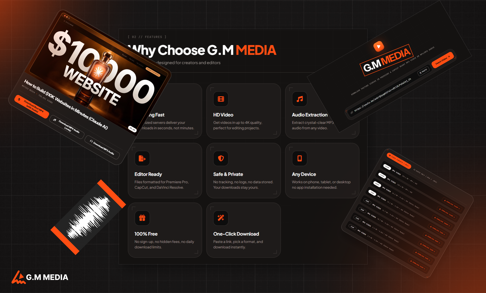

# 🎬 G.M MEDIA — YouTube Video & Audio Downloader

[](https://opensource.org/licenses/MIT)
[](https://nodejs.org/)
[](https://developer.mozilla.org/en-US/docs/Web/JavaScript)
[](http://makeapullrequest.com)

> A fast, dark-themed web application to download YouTube videos and audio in editor-ready formats (MP4, M4A, MP3). Built with vanilla JavaScript, Node.js, and a custom "Dark Tech + Orange" UI design system.



---

## 📖 Table of Contents

- [About the Project](#-about-the-project)
- [Features](#-features)
- [Tech Stack](#-tech-stack)
- [Project Structure](#-project-structure)
- [Getting Started](#-getting-started)
- [How It Works](#-how-it-works)
- [Contributing](#-contributing)
- [License](#-license)
- [Disclaimer](#-disclaimer)
- [Author](#-author)

---

## 🚀 About the Project

**G.M MEDIA** is a sleek, high-performance web application designed for content creators, editors, and developers. It allows users to easily fetch YouTube videos and extract them as high-quality video (MP4) or audio (MP3/M4A) files, ready to be imported directly into Premiere Pro, CapCut, or DaVinci Resolve.

The interface is built using a custom **Dark Tech + Orange** design system, focusing on high contrast, technical details, and a premium user experience.

---

## ✨ Features

- ⚡ **Lightning Fast:** Optimized backend server to fetch and process media quickly.
- 🎬 **HD Video Support:** Download videos in resolutions up to 4K.
- 🎵 **Audio Extraction:** Convert and download crystal-clear MP3 or M4A audio.
- 🎞️ **Editor Ready:** Formats are perfectly optimized for video editing software.
- 🛡️ **Safe & Private:** No tracking, no logs, and zero data stored on our servers.
- 📱 **Responsive Design:** Works seamlessly on desktop, tablet, and mobile devices.
- 🎨 **Premium UI:** Custom dark-mode design system with Font Awesome icons.

---

## 🛠️ Tech Stack

**Frontend:**
- HTML5 / CSS3
- Vanilla JavaScript (ES6+)
- Font Awesome 6 (Icons)
- Google Fonts (Plus Jakarta Sans & JetBrains Mono)

**Backend:**
- Node.js
- Express.js
- `yt-dlp` (Core download engine)

---

## 📁 Project Structure

```text
yt-grabber/
├── public/               # Frontend assets (served by Express)
│   ├── items/            # Images and UI assets (e.g., use.png)
│   ├── index.html        # Main HTML file
│   ├── style.css         # Custom Dark Tech + Orange design system
│   └── v.js              # Frontend JavaScript logic
├── server.js             # Express server & API endpoints
├── package.json          # Project dependencies and scripts
├── .gitignore            # Excluded files (node_modules, .exe, etc.)
└── README.md             # Project documentation


---

## 🚀 Getting Started

Follow these steps to run the project locally on your machine.

### Prerequisites

You need **Node.js installed on your computer. 
- [Download Node.js here](https://nodejs.org/) (v18 or higher is recommended).

### Installation

1. Clone the repository:**
   ```bash
   git clone https://github.com/Gamache-Mouaad/yt-grabber.git
   ```

2. **Navigate to the project directory:**
   ```bash
   cd yt-grabber
   ```

3. Install the dependencies:**
   ```bash
   npm install
   ```

4. Start the server:**
   ```bash
   npm start
   ```

5. Open your browser:**
   Navigate to `http://localhost:3000` (or the port specified in your `server.js`).

---

## ⚙️ How It Works

1. The user pastes a YouTube URL into the frontend interface.
2. The frontend sends a request to the Express backend.
3. The backend uses `yt-dlp` to fetch the video metadata and available formats.
4. The user selects their desired format (MP4 or MP3).
5. The backend processes the download and streams the file back to the user's browser.

---

## 🤝 Contributing

Contributions are what make the open-source community such an amazing place to learn, inspire, and create. Any contributions you make are **greatly appreciated**.

1. Fork the Project
2. Create your Feature Branch (`git checkout -b feature/AmazingFeature`)
3. Commit your Changes (`git commit -m 'Add some AmazingFeature'`)
4. Push to the Branch (`git push origin feature/AmazingFeature`)
5. Open a Pull Request

---

## 📄 License

Distributed under the MIT License. See `LICENSE` for more information.

---

## ⚠️ Disclaimer

This project is for educational purposes only.**
Downloading copyrighted material from YouTube without permission may violate YouTube's Terms of Service and local copyright laws. The author of this repository does not condone or encourage the downloading of copyrighted content. Please use this tool responsibly and only download content you own or have explicit permission to download.

---

## 👤 Author

Gamache Mouaad
- GitHub: [@Gamache-Mouaad](https://github.com/Gamache-Mouaad)
- Project Link: [https://github.com/Gamache-Mouaad/yt-grabber](https://github.com/Gamache-Mouaad/yt-grabber)

⭐If you like this project, please give it a star!** It helps a lot!
```

